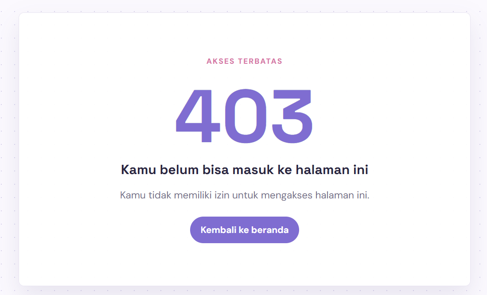

## 6.3 Read  → Break → Fix → Build
**Target akhir minggu**: REST API KampusLMS berjalan sesuai kontrak di Bagian 5 spesifikasi, terautentikasi dengan Sanctum, dan terdokumentasi.

### READ
1. Jalankan php artisan install:api. Baca perubahan yang terjadi di bootstrap/app.php.
2. Buat satu endpoint GET /api/v1/courses sederhana.
3. Bandingkan dengan CourseController versi web yang sudah ada. Tulis di catatan: apa yang sama dan apa yang berbeda di antara keduanya?
4. Panggil endpoint API tanpa header Accept: application/json. Lalu dengan header itu. Catat bedanya.
Jalankan php artisan route:list --path=api. Cocokkan dengan kontrak di spesifikasi.

Perubahan yang terjadi di `bootstrap/app.php` ketika menjalankan `php artisan intsall:api` ada di dalam configure:
**sebelum**:
```php
    ->withRouting(
        web: __DIR__.'/../routes/web.php',
        commands: __DIR__.'/../routes/console.php',
        health: '/up',
    )
    ->withMiddleware(function (Middleware $middleware) {
        $middleware->alias([
            'role' => EnsureUserHasRole::class,
        ]);
    })
    ->withExceptions(function (Exceptions $exceptions) {
        //
    });
```

**sesudah**:
```php
->withRouting(
        web: __DIR__.'/../routes/web.php',
        api: __DIR__.'/../routes/api.php',
        commands: __DIR__.'/../routes/console.php',
        health: '/up',
    )
    ->withMiddleware(function (Middleware $middleware) {
        $middleware->alias([
            'role' => EnsureUserHasRole::class,
        ]);
    })
    ->withExceptions(function (Exceptions $exceptions) {
        $exceptions->render(function (ValidationException $exception, Request $request) {
            if ($request->is('api/*')) {
                return response()->json([
                    'message' => 'Data yang diberikan tidak valid.',
                    'errors' => $exception->errors(),
                ], 422);
            }
        });

        $exceptions->render(function (HttpExceptionInterface $exception, Request $request) {
            if ($request->is('api/*') && $exception->getStatusCode() === 403) {
                return response()->json([
                    'message' => 'Anda tidak memiliki akses ke sumber daya ini.',
                ], 403);
            }
        });

        $exceptions->render(function (AuthenticationException $exception, Request $request) {
            if ($request->is('api/*')) {
                return response()->json(['message' => 'Unauthenticated.'], 401);
            }
        });
```
terlihat bahwa ada penambahan fungsi 'api' ketika mengunduhnya.

```php
Route::prefix('v1')->name('api.v1.')->middleware('throttle:60,1')->group(function () {
    Route::get('/courses', [CourseApiController::class, 'index'])->name('courses.index');
});
```

Contoh perbedaan kode di `CourseController.php`

```php
public function create(): View
    {
        $lecturers = User::where('role', 'dosen')->orderBy('name')->get();

        return view('courses.create', [
            'title' => 'Tambah Mata Kuliah',
            'lecturers' => $lecturers,
        ]);
    }
```
dan
```php
public function create()
    {
        Gate::authorize('create', Course::class);

        $lecturers = User::where('role', 'dosen')->get();

        return view('courses.create', compact('lecturers'));
    }
```
perbedaanya terletak pada authorize. Di setiap fungsi yang ditulis di class CourseController punya baris kode `gate::authorize()`--yang seperti namanya--berguna untuk pengecekan otorisasi. Laravel bisa memeriksa apakah user yang sedang login diizinkan melakukan aksi `create` terhadap model `course`.


```shell
  POST            api/v1/assignments ............................. api.v1.assignments.store › Api\AssignmentApiController@store
  PUT|PATCH       api/v1/assignments/{assignment} .............. api.v1.assignments.update › Api\AssignmentApiController@update
  DELETE          api/v1/assignments/{assignment} ............ api.v1.assignments.destroy › Api\AssignmentApiController@destroy
  GET|HEAD        api/v1/assignments/{assignment}/submissions api.v1.assignments.submissions › Api\AssignmentApiController@sub…
  POST            api/v1/assignments/{assignment}/submissions .. api.v1.assignments.submit › Api\AssignmentApiController@submit
  POST            api/v1/auth/login ................................................... api.v1.login › Api\AuthController@login
  POST            api/v1/auth/logout ................................................ api.v1.logout › Api\AuthController@logout
  GET|HEAD        api/v1/courses ......................................... api.v1.courses.index › Api\CourseApiController@index
  GET|HEAD        api/v1/courses/{course} .................................. api.v1.courses.show › Api\CourseApiController@show
  GET|HEAD        api/v1/courses/{course}/assignments ........ api.v1.courses.assignments › Api\CourseApiController@assignments
  GET|HEAD        api/v1/courses/{course}/materials .............. api.v1.courses.materials › Api\CourseApiController@materials
  GET|HEAD        api/v1/me ................................................................. api.v1.me › Api\AuthController@me
  GET|HEAD        api/v1/notifications .......................... api.v1.notifications.index › Api\NotificationController@index
  POST            api/v1/notifications/{notification}/read ........ api.v1.notifications.read › Api\NotificationController@read
  PUT             api/v1/submissions/{submission}/grade ............. api.v1.submissions.grade › Api\SubmissionController@grade
```

yang ingin di uji adalah `GET|HEAD  api/v1/courses .... api.v1.courses.index › Api\CourseApiController@index`


### BREAK


### Checkpoint question
- [ ] Kenapa mengembalikan model mentah berbahaya? Peragakan kebocorannya.
Berbahaya, karena model mentah seperti `user::all()` itu berarti seluruh atribut model yang tidak disembunyikan dapat ikut dikirim ke client. Artinya seluruh field database bisa ikut terekspos. API resource membuatnya lebih aman, karena hanya mengirim yang secara eksplisit dipilih. Contohnya:
```php
return response()->json(User::all());
```
response yang nanti dikasih itu semua semuanya.
tapi kalau
```php
return AssignmentResource::collection($assignments);
```
dengan ..Resource itu, kita bisa mengeluarkan yang perlu dikeluarkan aja.

- [ ] Apa beda 401 dan 403? Tunjukkan di API Anda satu contoh masing-masing.

**401 Unauthorized** berarti request belum terautentikasi atau token tidak valid

**403 Forbidden** berarti pengguna sudah terautentikasi tapi gk punya **hak** buat izin kesitu.


- [ ] Kenapa routes/api.php tidak ada secara default di Laravel 12? Bagaimana mengaktifkannya?
Karena API merupakan fitur opsional. Aplikasi yang hanya membutuhkan web routes tidak perlu konfigurasi API/Sanctum. Buat ngaktifkannya, jalankan `php artisan install:api`. Dan akan memasang semuanya secara otomatis.

Kemudian kita akan mendapatkan: `Route::get('/courses', ...);` yang diakses melalui `/api/courses`.

- [ ] Apa fungsi whenLoaded()? Apa yang terjadi tanpanya?
```php
'lecturer' => $this->whenLoaded('lecturer', fn () => new UserResource($this->lecturer)),
```
memastikan relationship hanya dimasukkan jika sudah di-eager load, sehingga API Resource tidak memicu query relationship satu per satu.

- [ ] Kenapa pesan gagal login tidak boleh membedakan email salah dan password salah?
Karena dapat digunakan untuk melakukan **user enumeration**. Bisa jadi mengetahui email mana yang terdaftar di sistem. Kalau sudah tahu email mana yang terdaftar, tinggal mencari kombinasi passwordnya.

- [ ] Kenapa endpoint login wajib di-throttle? Berapa nilai yang Anda pakai dan mengapa?
Berhubungan dengan "mencari kombinasi passwordnya." Endpoint login wajib di-_throttle_ untuk membatasi jumlah percobaan password sehingga serangan **brute force** tidak dapat mencoba ribuan kombinasi dalam waktu singkat. Untuk lms ini kita mengaturnya 5 request/menit

`curl.exe http://kampuslms-kelompok-04.test`: 
```shell
<!DOCTYPE html>
<html>
    <head>
        <meta charset="UTF-8" />
        <meta http-equiv="refresh" content="0;url='http://kampuslms-kelompok-04.test/login'" />

        <title>Redirecting to http://kampuslms-kelompok-04.test/login</title>
    </head>
    <body>
        Redirecting to <a href="http://kampuslms-kelompok-04.test/login">http://kampuslms-kelompok-04.test/login</a>.
    </body>
</html>
```

`curl.exe http://kampuslms-kelompok-04.test/api/v1/courses`: 
```shell
{"message":"Unauthenticated."}
```
